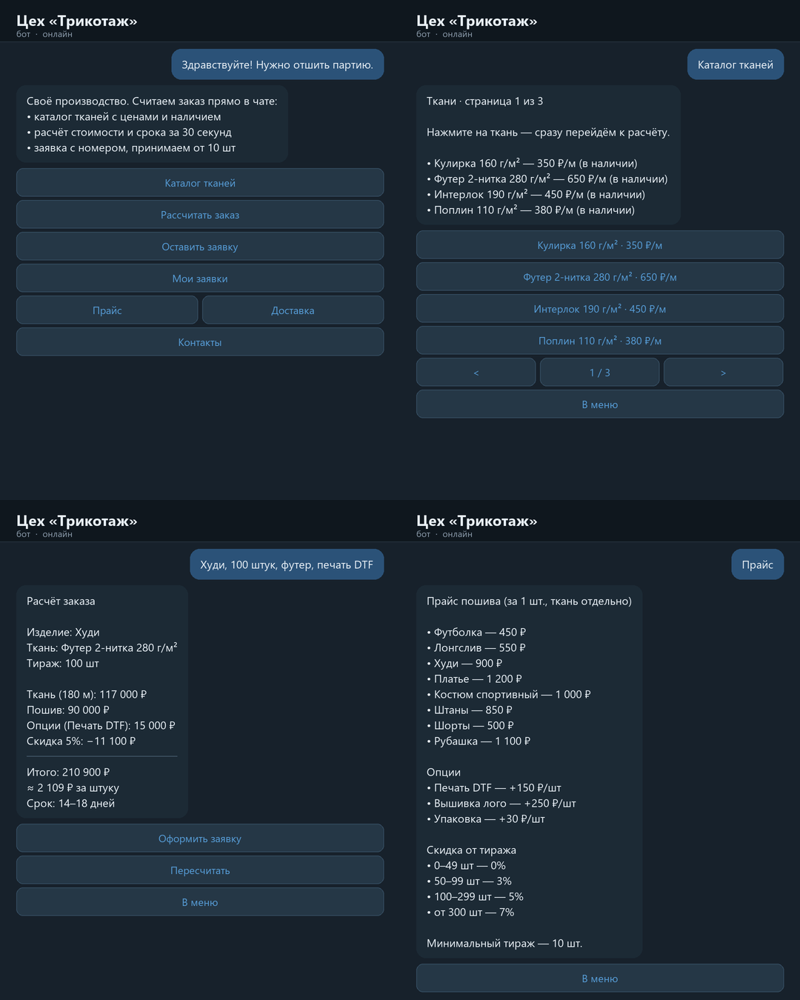

# Telegram-боты и автоматизация для малого бизнеса

Привет! Меня зовут Михаил. Делаю Telegram-ботов и автоматизацию: заявки не теряются,
рутина уходит в скрипты, данные собираются в базу сами.

Работаю по принципу «результат за срок»: сначала ТЗ и фикс-цена, потом код.

## Услуги

| Услуга | Что получает заказчик | Срок | Цена |
|---|---|---|---|
| Telegram-бот приёма заявок | клиент заполняет форму в боте → заявка в чат + база | 1–2 дня | от 2 500 ₽ |
| Бот-каталог / запись / напоминания | меню с товарами или слотами, уведомления | 2–3 дня | от 4 000 ₽ |
| Парсер → база данных | сбор данных в SQLite/PostgreSQL, выгрузка в Excel/CSV | 1 день | от 1 500 ₽ |
| Интеграции (Google Sheets, CRM, API) | данные из бота летят в таблицу или CRM | от 2 часов | от 1 000 ₽ |
| Настройка VPS под проект | сервер, Docker, автозапуск, бэкапы, мониторинг | 3–4 часа | от 1 500 ₽ |

## Проекты в этом репозитории

| Папка | Что внутри |
|---|---|
| [`bot-orders/`](bot-orders/) | Telegram-бот приёма заявок на aiogram 3: пошаговая форма, SQLite, уведомление администратору, Dockerfile и docker-compose |
| [`parser-to-db/`](parser-to-db/) | Парсер каталога в SQLite + отчёт в CSV: сбор, дедупликация, экспорт |
| [`vps-setup/`](vps-setup/) | развёртывание на VPS: защита сервера, Docker, автозапуск, логи, скрипт ежедневного бэкапа |
| [`textile-bot/`](textile-bot/) | бот для швейного цеха: каталог тканей, калькулятор тиража с ценой и сроком, заявки с номерами, админка |

Каждая папка — самостоятельный проект с инструкцией запуска.

## Демо-кейс: бот для швейного цеха

Клиент открывает бота, смотрит ткани с ценами, сам считает тираж
(изделие → тираж → ткань → опции), видит итоговую цену и срок — и оставляет заявку,
которая с номером уходит менеджеру в Telegram. В админке заявки двигаются по статусам.

Под конкретный цех меняется один файл — `config.py` (ткани, изделия, опции, скидки),
а скриншоты перерисовываются кодом. Демо собрано под вымышленный цех «Трикотаж»:
под реального клиента меняется только конфиг. Подробнее: [`textile-bot/`](textile-bot/).

## Стек

- **Python 3.11+**, aiogram 3, requests, BeautifulSoup
- **SQLite / PostgreSQL**, SQL, отчёты в CSV/Excel
- **Linux, Docker, docker-compose**, systemd, cron-бэкапы
- **n8n** для автоматизаций без кода

## Как заказать

- Telegram: [@Mrgradi](https://t.me/Mrgradi)
- Email: [deineko.misha@mail.ru](mailto:deineko.misha@mail.ru)

Опишите задачу в двух предложениях — отвечу со сроком и ценой в тот же день.

---

Лицензия: [MIT](LICENSE). Код в репозитории можно использовать как основу для своих проектов.
