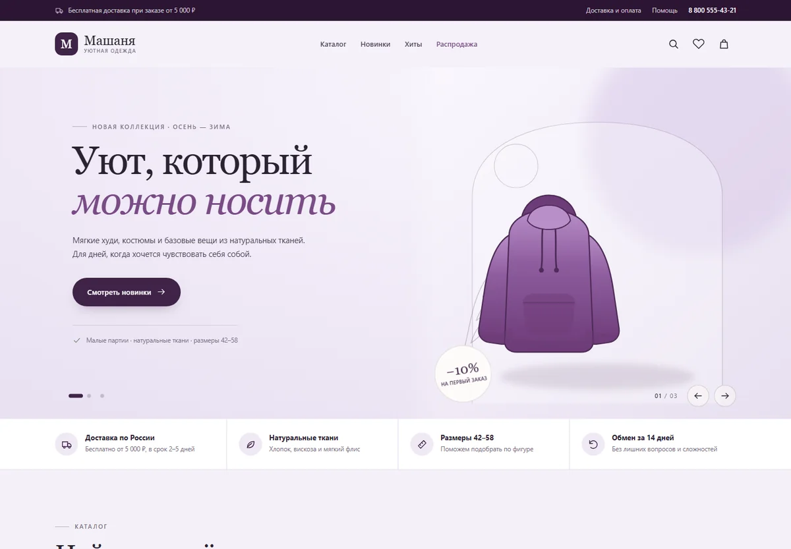
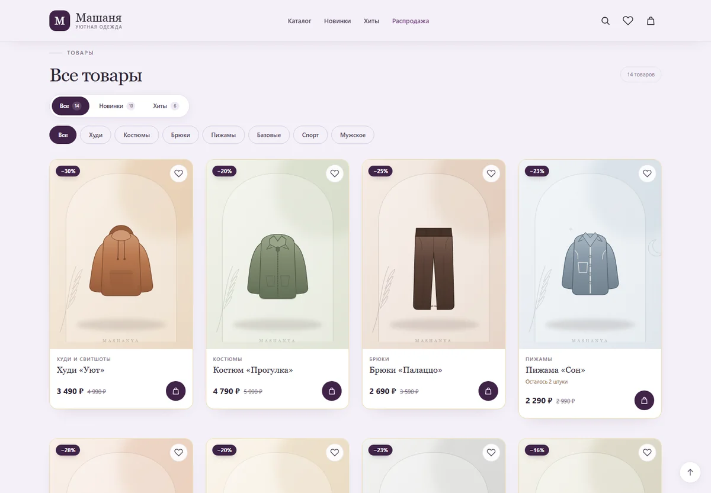
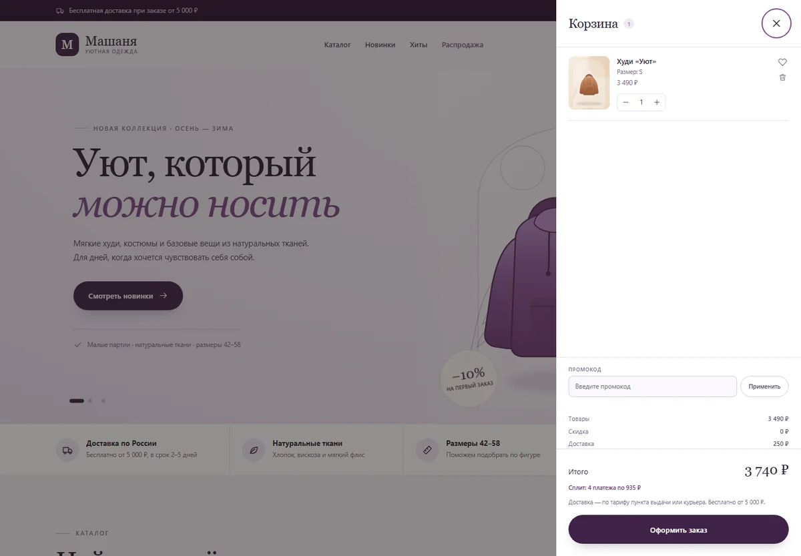
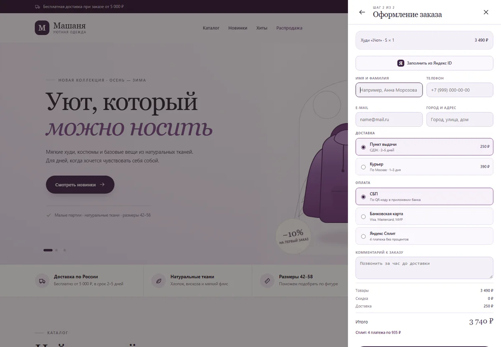
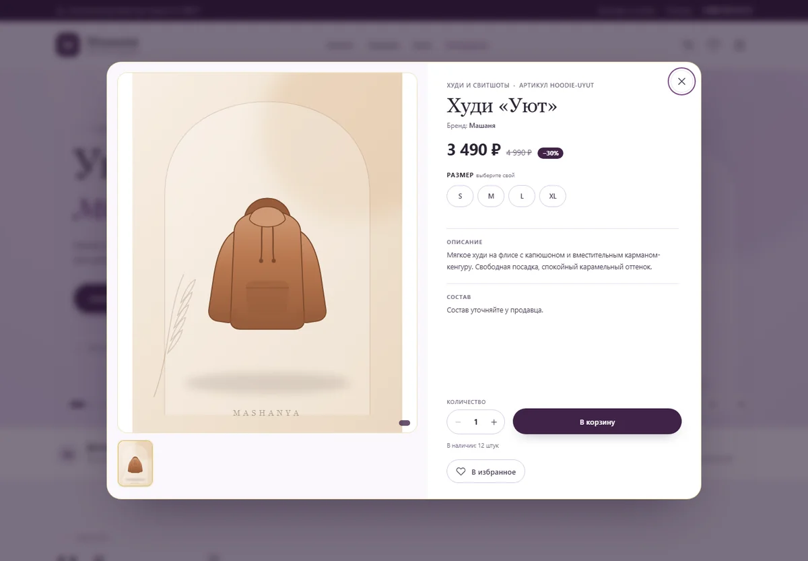

# MASHANYA — интернет-магазин домашней одежды

Демонстрация проекта, в разработке которого я участвовал: витрина для бренда
домашней одежды — каталог, корзина, оформление заказа, доставка, возвраты, размеры, FAQ.
Сайт работает: [mashanya-shop.ru](https://mashanya-shop.ru).

## Задача

Небольшой бренд одежды продавал через соцсети: заказы шли в личку, размеры и наличие
уточнялись в переписке, часть обращений терялась. Нужен был сайт, который сам показывает
товар, собирает корзину и оформляет заказ — без менеджера в каждом шаге.

## Что сделано

- **Витрина и каталог** — категории (брюки, пижамы, спорт, мужское), карточки товаров, новинки, хиты, распродажа, быстрый просмотр.
- **Корзина и оформление заказа** — выбор доставки (ПВЗ / курьер), оплата (СБП, карта, Яндекс Сплит), комментарий к заказу, итог с доставкой.
- **Контентные страницы** — доставка и оплата, обмен и возврат, таблица размеров, FAQ, контакты, публичная оферта, политика конфиденциальности.
- **Приём оплаты** — интеграция ЮKassa, страница успешной оплаты.
- **Админка** — заказы, товары, статусы (внутренний инструмент, в публичную версию не входит).
- **SEO и разметка** — sitemap, robots, микроразметка, счётчик аналитики.
- **Деплой** — статика на nginx, сборка и выкладка скриптом, настройка HTTPS.

## Скриншоты

| | |
|---|---|
|  **Каталог** — фильтры, категории, карточки |  **Корзина** — товары, количество, итог |
|  **Оформление** — доставка и оплата в одном шаге |  **Быстрый просмотр** — товар без перехода на страницу |

Мобильная версия: каталог и оформление адаптированы под телефон — основная часть трафика
у таких магазинов мобильная.

## Стек

- **Frontend:** HTML, CSS, JavaScript без фреймворков; каталог из JSON; корзина и оформление на клиенте.
- **Backend:** Node.js — API для заказов и админки.
- **Оплата:** ЮKassa (СБП, карты, Сплит).
- **Инфраструктура:** nginx, HTTPS, деплой-скрипт, резервные копии.

## Что не публикуется

Исходный код, админка, серверная часть и интеграции оплаты принадлежат заказчику
и по договорённости не выкладываются. В репозитории — только описание и скриншоты
публичных страниц, которые и так видны на работающем сайте.

Если нужен похожий магазин — напишите, обсудим сроки и цену:
[@Mrgradi](https://t.me/Mrgradi) · [deineko.misha@mail.ru](mailto:deineko.misha@mail.ru)
