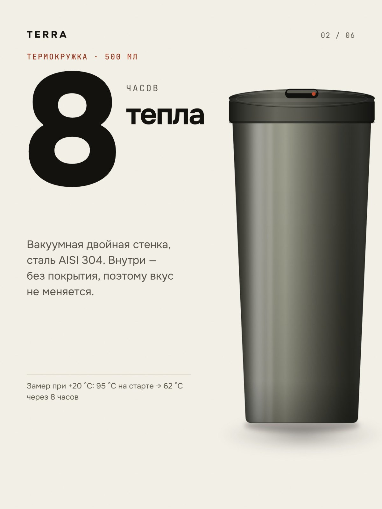
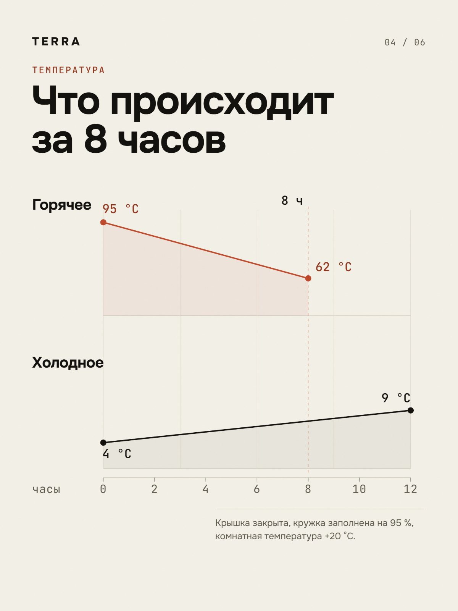
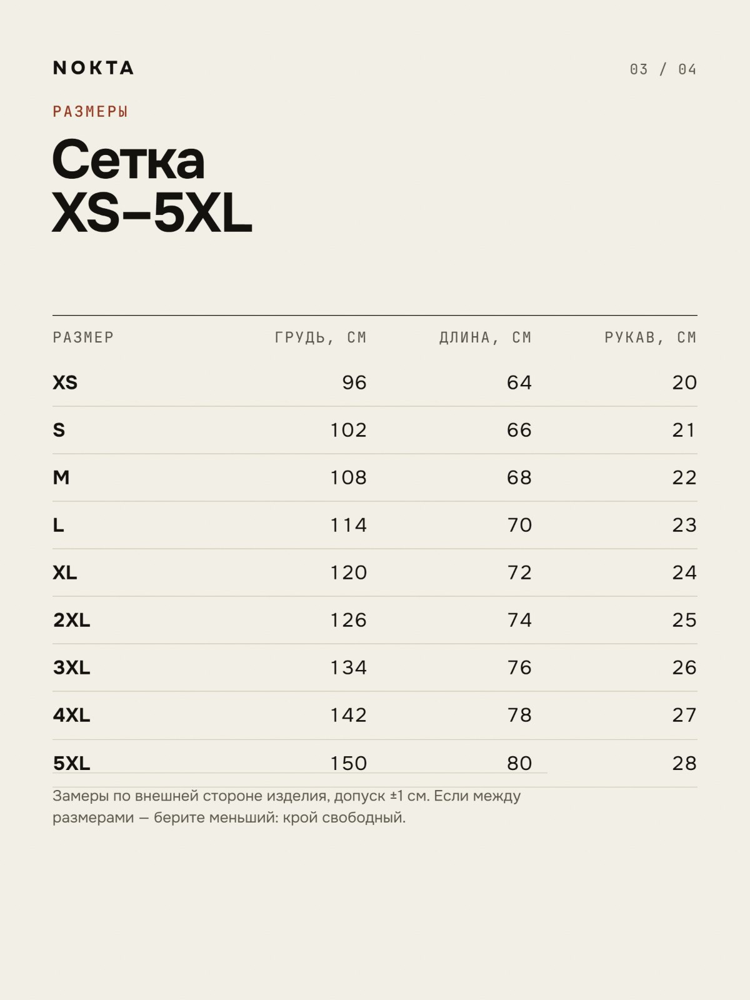
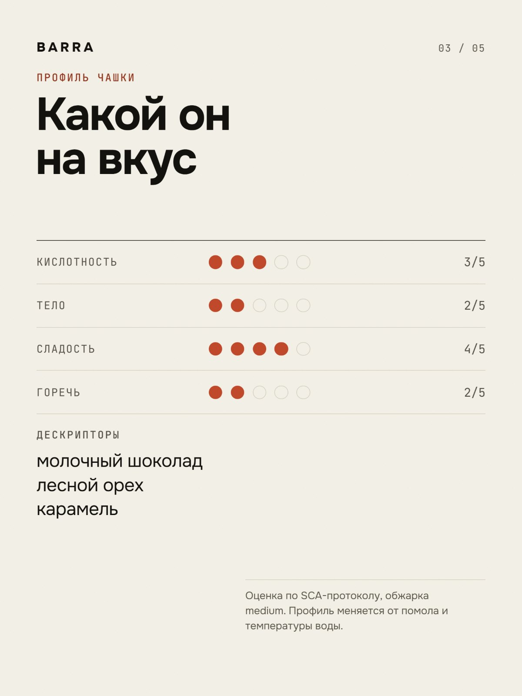
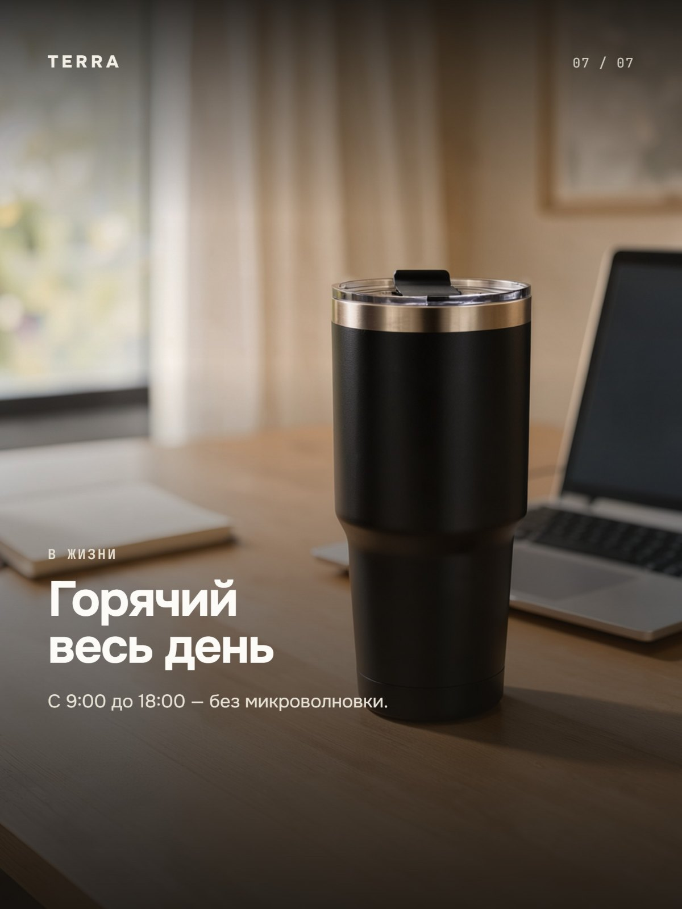
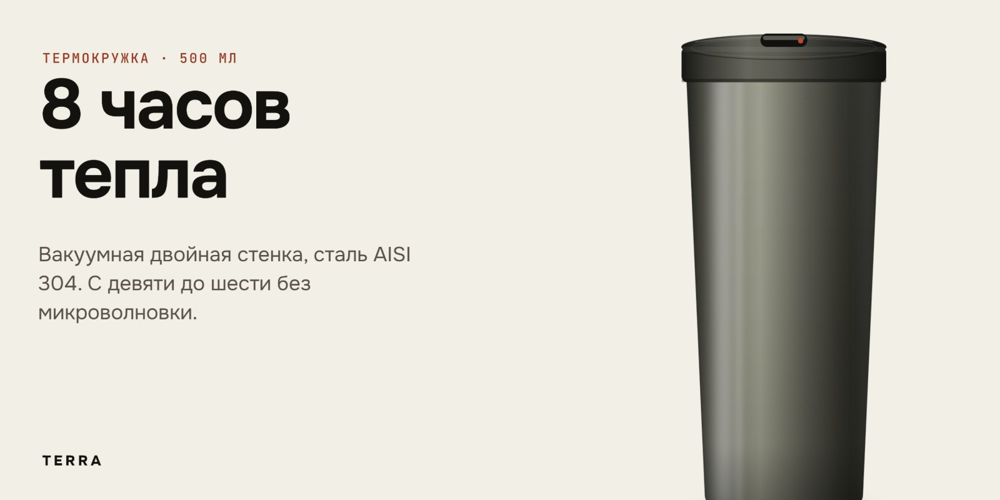
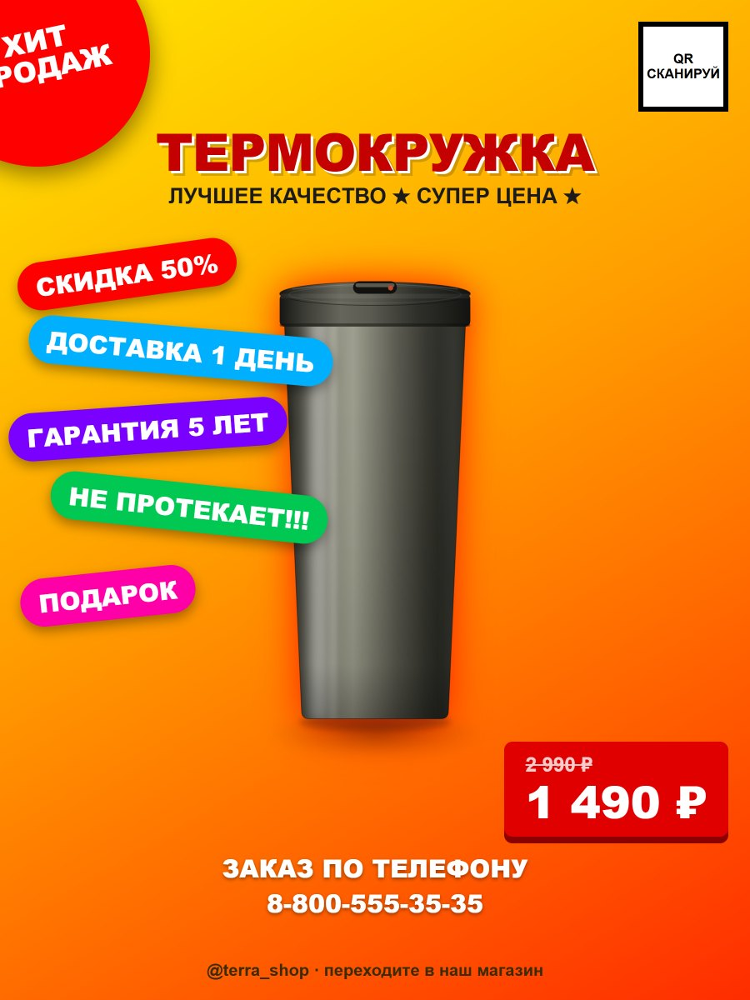
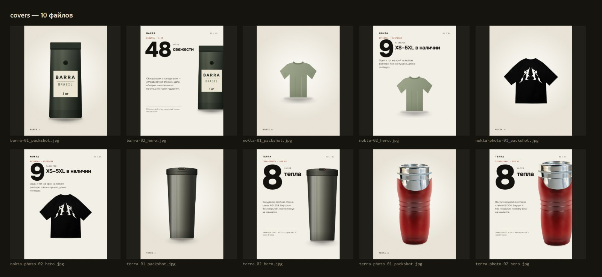
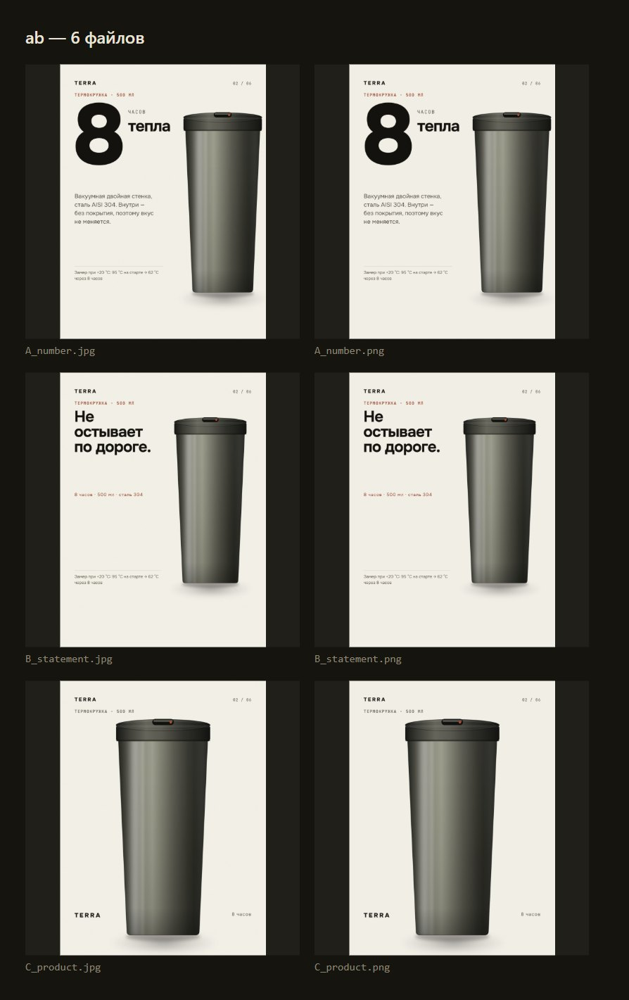

# Система проверки карточки

Не отдельный кейс, а то, чем проверяется любая карточка перед сдачей.

Проблема простая: на глаз «вроде нормально», а на телефоне текст 3,4:1 не читается,
сноска уезжает под плашку площадки, заголовок не влезает в миниатюру 180 px.
Поэтому проверки не глазами, а замером.

## Что проверяется

- **Контраст по фактическим пикселям.** Слайд рендерится второй раз с прозрачным текстом,
  и цвет букв сравнивается с тем, что реально лежит под ними: фон, фото, градиент.
  «Серый для элегантности» отсекается сразу — это самая частая причина нечитаемых подписей.
- **Наезды.** Текст не пересекается ни с товаром, ни с другим текстом: сноска поверх
  размерной таблицы — типичный брак, который видно только в собранном макете.
- **Геометрия площадки.** Поля, зоны бейджей внизу кадра, размер 3:4, вес файла.
- **Читаемость на миниатюре.** Главный текст пересчитывается в размер 180 px:
  если меньше 8 px — в выдаче он не существует.
- **Текст.** Отдельный линтер: запрещённые слова и «хит/топ/скидка», цены и контакты на фото,
  длина строк, дубли, отсутствие цифры в главной выгоде.

## Проверки тоже проверены

Карточку ломают девятью способами — мелкий кегль, низкий контраст, текст в зоне бейджа,
текст поверх товара, текст на тексте, выход за кадр, нечитаемость на миниатюре,
пустая полоса, висячее слово — и каждая поломка обязана быть поймана. Сейчас 9 из 9.
Иначе «0 ошибок» означало бы «проверки сломаны».

## Полка, а не отдельная карточка

Линейка проверяется целиком: палитра, шум, центр визуального веса. Если у одного товара
фон кислотный, а у другого нейтральный, в выдаче это выглядит как два разных продавца.

## Что это даёт

- правки на этапе макета, а не после отклонения модерацией;
- линейка из 10 SKU не разъезжается по плотности и типографике;
- спор «мне кажется, мелко» закрывается замером, а не вкусом.

## Цифры текущего прогона

| Показатель | Значение |
|---|---|
| Слайдов | 64 (6 наборов × 2 площадки) |
| Ошибок аудита | 0 |
| Самопроверка аудита | 9 из 9 |
| Минимальный контраст | 4,8:1 при пороге 4,5:1 |
| Минимальный кегль | 17,1 px при ширине 900 |

## Примеры

|  |  |  |
|---|---|---|
| Главная выгода цифрой | Данные вместо обещаний | Размерная сетка |

|  |  |  |
|---|---|---|
| Профиль вкуса шкалами | Слайд «в жизни» | Рич-контент Ozon, 2:1 |

**Почему это не «просто красиво»:** рядом с рабочим макетом антипример, и разница измерима —
насыщенность фона 0,96 против 0,06, двадцать цветов против восьми.

**Полка: центр визуального веса.** Пакшоты 0,499, обложки с товаром справа 0,641,
вертикальная композиция 0,474 — каждая группа в свою сторону, выбросов нет.

**Варианты обложки для A/B.** К каждому посчитано, сколько показов нужно, чтобы разница
была различима: прирост +0,5 п.п. CTR требует ≈25 500 показов на вариант.

## Честно о примерах

Товары в примерах — демонстрационные (термокружка, кофе, футболка). Это не клиентские бренды:
показана система и уровень контроля, а не работа под заказчика. Пакшоты частично векторные,
частично сгенерированы локально; фото с Wikimedia Commons использованы под свободными
лицензиями с указанием авторства. На реальной карточке товар всегда настоящий —
сгенерировать можно фон и сцену, но не товар.

## Чем сделано

Node и локальный Chrome (рендер HTML/CSS → PNG), Python и ComfyUI для сцен и фонов,
Photopea для ручной доводки краёв. Без конструкторов и подписок: вся сборка идёт локально.
