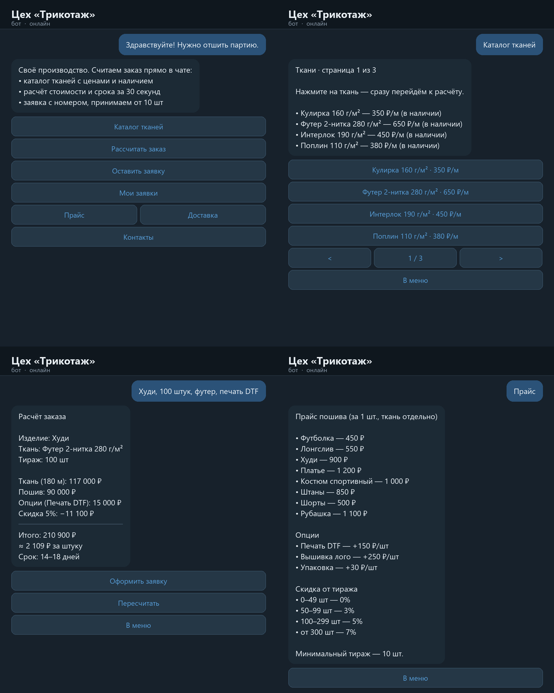
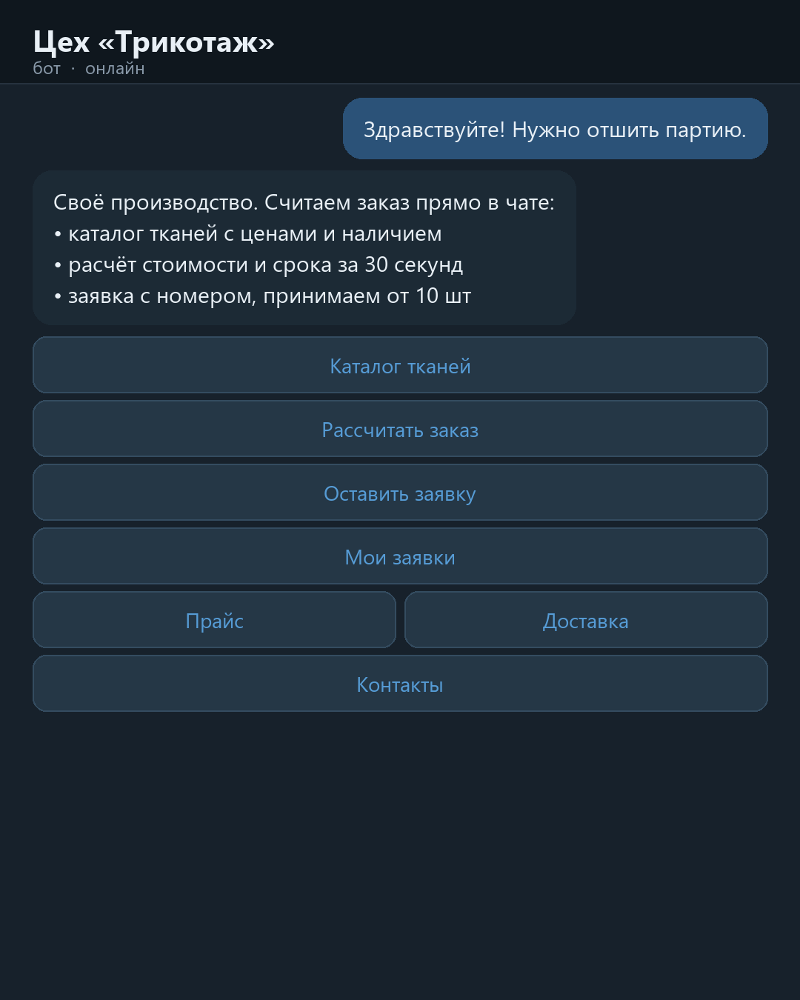
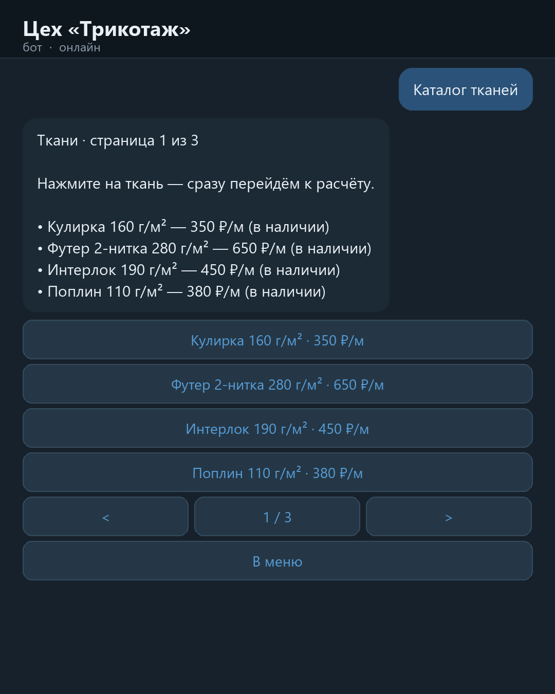
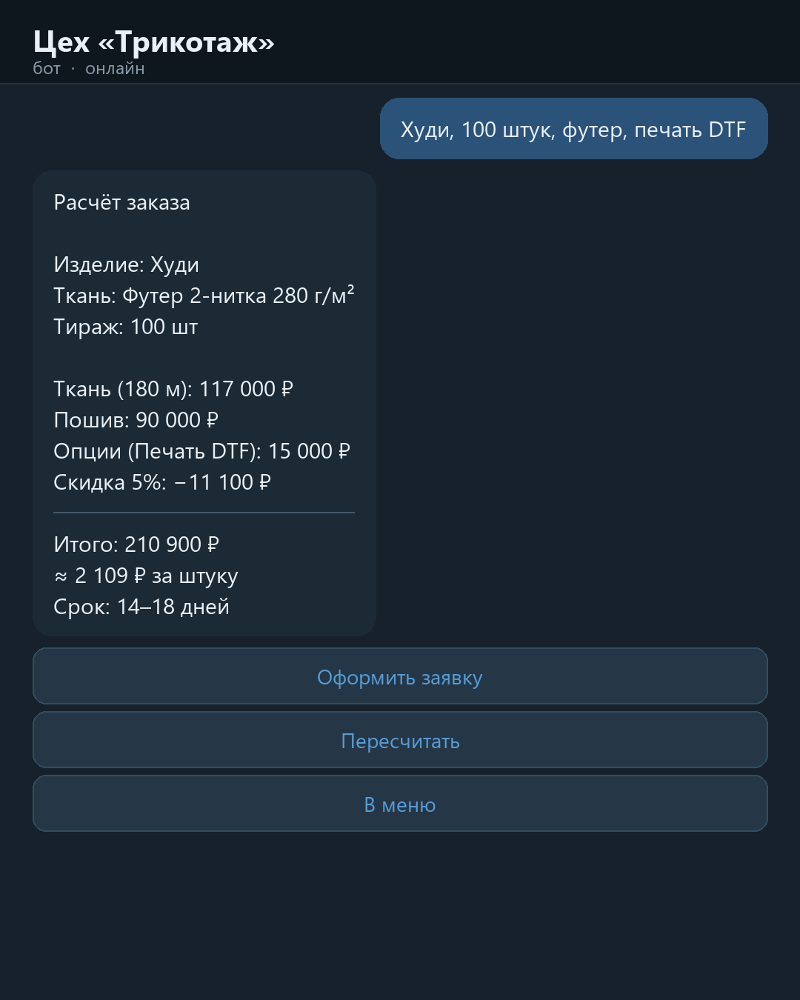
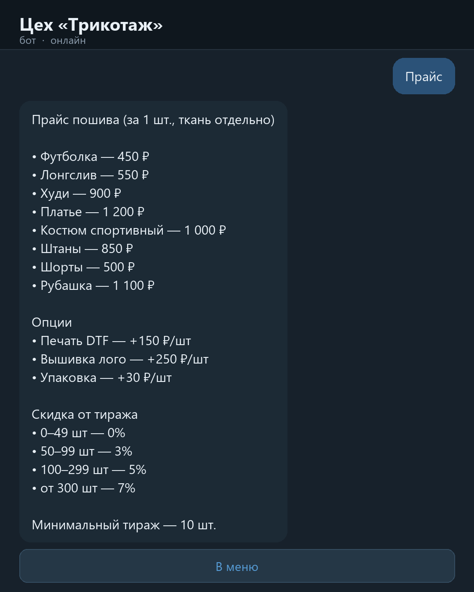
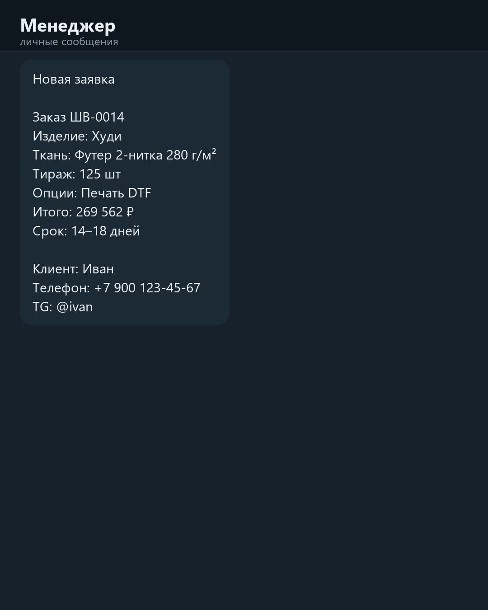
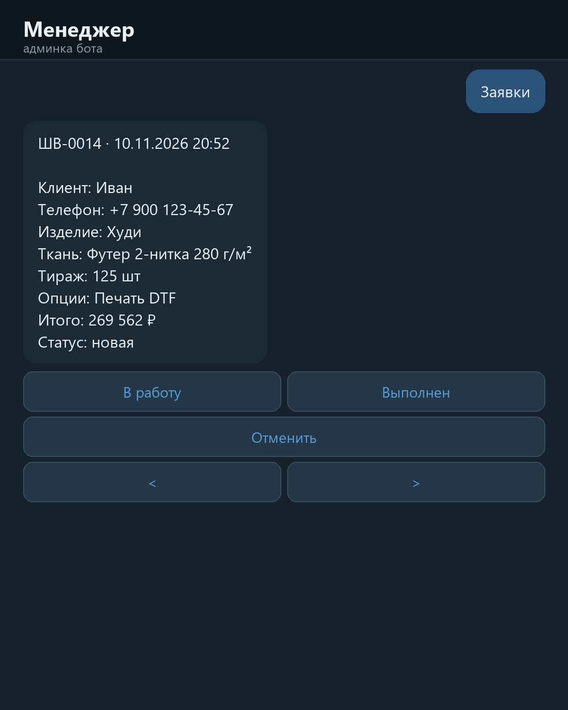
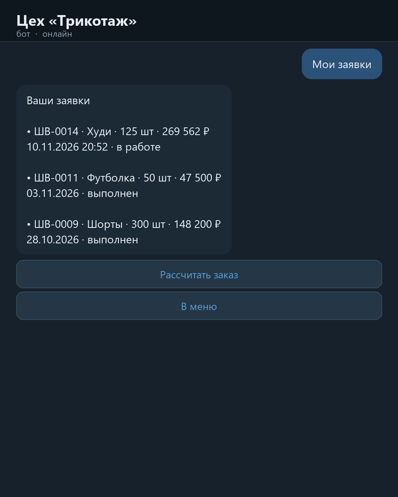

# «Цех в Telegram» — бот приёма и расчёта заказов

Кейс под швейное производство: клиент открывает бота, смотрит ткани с ценами,
сам считает тираж и оставляет заявку, которая падает менеджеру в Telegram.
Ни сайта, ни менеджера на телефоне — всё в чате.



## Задача

У небольших цехов заказы теряются в переписках: клиент спрашивает цену,
менеджер считает вручную в блокноте и отвечает через день. Нужно было сделать так,
чтобы клиент считал сам и сразу видел цену и срок, а заявка не терялась.

## Что умеет

- **Каталог тканей** — цена за метр и наличие («в наличии» / «под заказ, 5–7 дней»).
- **Калькулятор заказа** — изделие → тираж → ткань → опции (DTF-печать, вышивка, упаковка, стикеры) → итоговая цена, цена за штуку и срок.
- **Скидка от тиража** считается сама: 50–99 шт — 3%, 100–299 шт — 5%, от 300 шт — 7%.
- **Заявка с номером** `ШВ-0001` уходит менеджеру в Telegram.
- **«Мои заявки»** — клиент видит свои заказы и их статусы.
- **Админка** `/admin` — список заявок, смена статуса (новая → в работе → выполнен / отменён), `/stats` — количество и сумма.

## Скриншоты

| Экран | Что показывает |
|---|---|
|  | Главное меню: каталог, расчёт, заявка, прайс, контакты |
|  | Каталог тканей с ценами и наличием, постранично |
|  | Расчёт: 100 худи из футера 280 г/м² с DTF — 2 109 ₽/шт, срок 14–18 дней |
|  | Прайс пошива и опций, скидочная сетка |
|  | Карточка заявки, которая приходит менеджеру |
|  | Управление заявками и статусами |
|  | Личный кабинет клиента |

## Как считается цена

```
ткань  = расход на изделие (м) × цена ткани (₽/м) × тираж
пошив  = стоимость пошива изделия × тираж
опции  = сумма опций × тираж
итого  = (ткань + пошив + опции) × (1 − скидка от тиража)
за штуку = итого / тираж
```

Пример из калькулятора: 100 худи, футер 2-нитка 280 г/м², печать DTF —
ткань 117 000 ₽, пошив 90 000 ₽, опции 15 000 ₽, скидка 5% (−11 100 ₽),
итого 210 900 ₽, ≈2 109 ₽ за штуку, срок 14–18 дней.

## Стек

- **Python 3.9+**, только стандартная библиотека: `urllib`, `sqlite3`, `json` — ставится на любой сервер без pip.
- **Telegram Bot API** напрямую (inline-клавиатуры, редактирование сообщений).
- **SQLite** для заявок: номера, статусы, статистика.
- **Генерация картинок кодом** — `make_shots.py` рисует скриншоты, `make_cover.py` — обложку и аватар.

## Структура

```
textile-bot/
├── bot.py           # логика: каталог, калькулятор, заявки, админка
├── config.py        # ВСЁ содержимое цеха: ткани, изделия, опции, скидки, тексты
├── db.py            # заявки в SQLite, статусы, статистика
├── make_shots.py    # генерация скриншотов
├── make_cover.py    # обложка и аватар
├── _flowtest.py     # прогон всего диалога без Telegram
├── start.bat        # запуск двойным кликом (Windows)
└── shots/           # готовые экраны
```

## Запуск

```bash
cp .env.example .env      # вписать BOT_TOKEN и MANAGER_ID
python bot.py --selftest  # проверка расчётов без Telegram
python _flowtest.py       # прогон диалога: каталог → расчёт → заявка → админка
python bot.py             # запуск бота
```

## Как адаптировать под конкретный цех

Меняется только `config.py`:

- `SHOP` — название, телефон, адрес, часы, доставка;
- `FABRICS` — реальные ткани и цены;
- `ITEMS` — что шьют, цена пошива, расход ткани;
- `OPTIONS` — допуслуги;
- `MIN_QTY` — минимальный тираж.

Затем `python make_shots.py` — скриншоты перерисуются с новыми цифрами.
Демо под конкретного клиента собирается за 20 минут: «я уже вбил ваши ткани
из вашего прайса — откройте».
